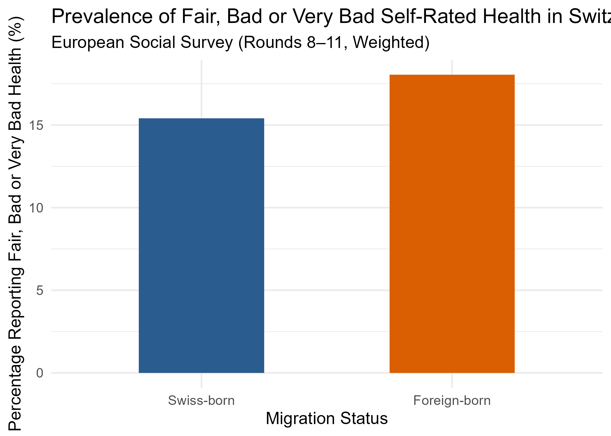

# Swiss Migrant Health Analysis (ESS Rounds 8–11)

Survey-weighted analysis of self-rated health among foreign-born and Swiss-born residents of Switzerland, using European Social Survey (ESS) rounds 8–11 (2016–2023). Self-directed project by Mariam Mosidze.

## Research question
Is foreign-born status associated with fair, bad or very bad self-rated health in Switzerland, after adjusting for age, gender, education, income and survey round?

## Data
European Social Survey, Switzerland, rounds 8–11. The raw data are **not included** (ESS licence). Download them free from [europeansocialsurvey.org](https://www.europeansocialsurvey.org).

The script expects one CSV combining ESS rounds 8–11 (Switzerland), placed in `data/`, containing these variables: `essround`, `cntry`, `pspwght`, `brncntr`, `health`, `eisced`, `hinctnta`, `agea`, `gndr`. Update the file name in the script if yours differs.

## Methods
- **Outcome:** fair, bad or very bad self-rated health (ESS `health` = 3–5) vs very good or good (1–2)
- **Exposure:** foreign-born (`brncntr` = 2) vs born in Switzerland
- **Covariates:** age, gender, education (ISCED, treated as a numeric scale), household income decile, ESS round (fixed effects)
- **Model:** survey-weighted logistic regression (`survey::svyglm`, quasibinomial) using post-stratification weights (`pspwght`)
- **Missing data:** complete-case analysis (N = 4,864 of 5,966 respondents); see `output/missing_data_report.csv`
- **Software:** R 4.6.1; packages `survey`, `tidyverse`, `here`

## Results
Sample: N = 4,864; foreign-born n = 1,336; Swiss-born n = 3,528.

| Model | OR (foreign-born vs Swiss-born) | 95% CI | p |
| :--- | :--- | :--- | :--- |
| M1 unadjusted (+ round) | 1.21 | 1.02–1.43 | 0.026 |
| M2 adjusted | 1.29 | 1.08–1.54 | 0.005 |

Foreign-born respondents had higher odds of fair, bad or very bad self-rated health than Swiss-born respondents, with and without adjustment.

## Limitations
- Cross-sectional design: associations only, no causal interpretation
- Self-reported health
- "Foreign-born" combines groups with very different origins, migration reasons and time in Switzerland
- About 18% of respondents were excluded for missing data (complete-case analysis)
- Weights only; standard errors do not account for clustering or stratification
- Education modelled as a numeric scale

## Project structure
- `scripts/01_migrant_health_ess.R` – cleaning, modelling, figure
- `output/` – odds-ratio table, missing-data report, figure, session info
- `data/` – instructions only (raw data not included)

## How to reproduce
1. Download the ESS data and save the combined CSV in `data/`.
2. Open the project in RStudio and run `scripts/01_migrant_health_ess.R`.
